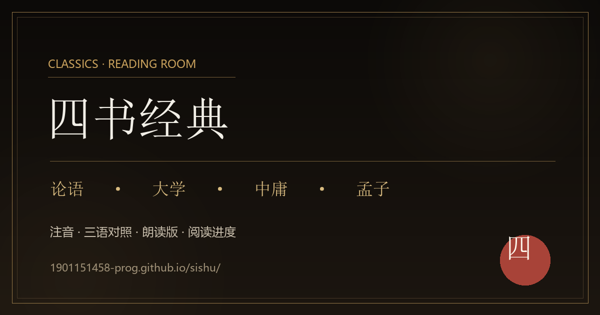

# 四书经典 · 阅读室



中华经典（《论语》《大学》《中庸》《孟子》）的静态阅读站点：原文、注音、三语对照、朗读与阅读进度。

**在线访问：<https://1901151458-prog.github.io/sishu/>**

## 内容

| 板块 | 说明 |
| --- | --- |
| 论语 | 二十篇全文、朱熹集注、朗读版 |
| 大学 | 经一章、传十章，含注音与朗读 |
| 中庸 | 三十三章，含注音与朗读 |
| 孟子 | 七篇十四卷，含注音与朗读 |
| 礼记 / 孝经 / 易经 / 近思录 / 传习录 | 扩展经典阅读 |
| 四句教 / 太极图说 / 横渠四句 | 专题页面 |

## 功能

- 原文 / 注音 / 三语对照切换；
- 朗读模式：自动横移、速度调节、纯净模式；
- 阅读进度、书签、上次阅读位置保存在浏览器本地；
- 深色 / 浅色主题；
- 长文页支持 A4 打印；
- 静态站点，无需登录，无后端。

## 目录结构

```text
index.html                 首页
lunyu/                     论语
daxue/                     大学
zhongyong/                 中庸
mengzi/                    孟子
xiaojing/                  孝经
jinsilu/                   近思录
chuanxilu/                 传习录
sijujiao/                  四句教
assets/                    样式、脚本、图标、搜索索引
sitemap.xml
```

## 本地预览

```bash
python -m http.server 8080
# 打开 http://localhost:8080/
```

## 说明

- 原文与注疏以中华书局版本为主要依据；
- 注音、译文与朗读为学习辅助，不替代原典与纸本；
- 站点为纯静态托管，阅读进度仅保存在当前浏览器。

## 社交预览

`assets/social-preview.png` 为 1200×630 的社交预览图。  
在 GitHub 仓库 **Settings → Social preview** 上传该文件即可用于链接分享卡片。
